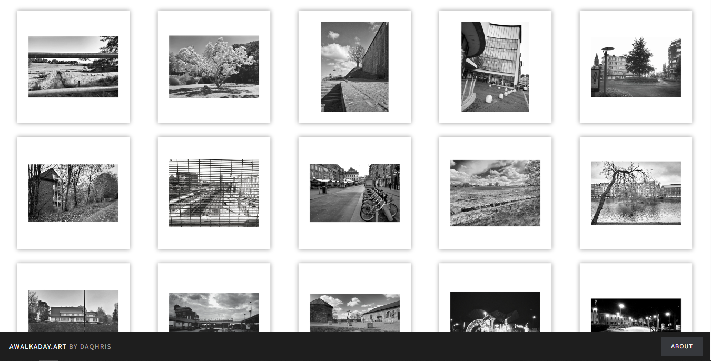
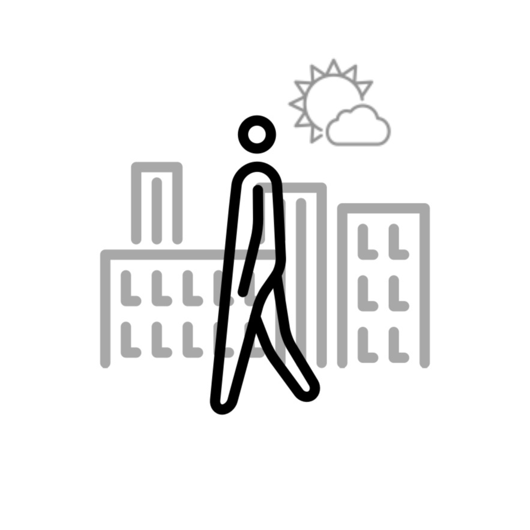

# awalkaday.art Photography Collection
This is the __code repository__ of a web gallery, mainly built in _JavaScript_, that is used to exhibit a digital photo collection.  

  

## Highlights
1. __Easy__ setup and __lightweight__ web gallery.
2. __No complex code__ changes required. 
3. __Responsive & fast__ display for various devices.

## Quick Start
If you have basic knowledge of web development, then this open-source project may help you set up a web application to showcase all your visual creations without much effort.  

Follow the steps below and your site will be live in no time:  

1. Fork this repo by clicking the `Fork` button at the top right corner.
2. Enable _GitHub Pages_ in the code repository settings.
3. Upload your pictures to the `images` directory. (You may do that via _GitHub.com_ or clone/push the images to your repo.)
4. Add your own web domain in the `CNAME` file or just delete the file if you don't own a domain in order to use the default domain that _GitHub_ provides.
5. Leave `baseurl` empty in `_config.yml` (the site is served from the root of your domain) and set `url` to your domain.
6. And that's it, your web app is set and ready. To view the results, visit the link configured in the CNAME file. In this particular case, the web address is [awalkaday.art](https://awalkaday.art).

It is possible to modify the short site description shown on the front-page's bottom area by editing the `_config.yml` file.  
Site navigation pointers, such as social media icons, contact methods, external links, license documents, legal statements, ... are located in the footer section. 

  
 
## Deployment Guide
The site is a [Jekyll](https://jekyllrb.com/) project published with _GitHub Pages_. The only build tool you need is [Node.js](https://nodejs.org/) (version 20 or newer), used to resize photographs with [sharp](https://sharp.pixelplumbing.com/).  

Do the following before you push your images to a remote code repository:

1. Fork and then, clone the project to your computer, and go inside the project's root folder.
2. Install the single dependency with `$ npm install`.
3. Copy your photographs (if possible: in JPG file format, of the largest size available, straight from your camera memory card) inside the `images` directory.
4. Run `$ npm run images` to create the 1024 px version (`images/fulls`) and the 512 px thumbnail (`images/thumbs`) of every photograph. Metadata, including GPS position, is removed. Your originals are kept; add `-- --delete-originals` if you prefer them removed once resized.
5. Add your local code changes to a remote server by using `$ git add --all` then, follow up with a [signed commit](https://docs.github.com/en/github/authenticating-to-github/managing-commit-signature-verification/signing-commits) `$ git commit -S -m "a short and descriptive commit message"` and lastly, update your remote code repo with the command `$ git push origin master`.  

To preview the site locally: `$ bundle install` then `$ bundle exec jekyll serve` and open <http://localhost:4000>.

### Optional details for each photograph
Create entries in [`_data/photos.yml`](_data/photos.yml) to give a photograph a title, a description for screen readers, or a link to its token on the Ethereum blockchain. The key is the first 8 characters of the file name. Photographs without an entry still display normally.

### Where things are
- `index.html` — page markup and the small inline script that randomises order and crop on every visit.
- `assets/js/gallery.js` — photograph viewer and About panel (no dependencies).
- `assets/css/gallery.css` — photo grid and viewer styles. `assets/css/main.min.css` still holds the Multiverse base styles (header, footer, typography).
- `docs/AUDIT.md` and `docs/ROADMAP.md` — findings and the plan for the next renovation steps.

## Credits
__Forked__ from: [rampatra/photography](https://github.com/rampatra/photography) — Enhanced for [Jekyll](https://jekyllrb.com/) by [Ram  Patra](https://github.com/rampatra) — Code reused under [GPL-3.0 License](https://raw.githubusercontent.com/rampatra/photography/master/LICENSE).   
__Template__: [Multiverse by HTML5 UP](https://html5up.net/multiverse) — Web designer and developer: [ajlkn](https://aj.lkn.io/).  
__Fonts__: [Source Sans 3](https://github.com/awalkaday/awalkaday-art/blob/master/assets/fonts/SourceSans3-Regular.ttf) — Used under: [SIL Open Font License](https://raw.githubusercontent.com/daqhris/daqhris.github.io/master/style/font/license/OFL.txt).  
__Icons__ made from: [OpenMoji](https://openmoji.org/about/) — Remixed under [CC BY-SA 4.0](https://creativecommons.org/licenses/by-sa/4.0/legalcode).  

## Copyrights
__Code__ Open-source License: [European Union Public License 1.2](https://raw.githubusercontent.com/awalkaday/awalkaday-art/master/LICENSE).    
__Content__ Legal Rights: [Attribution-NonCommercial-NoDerivs 4.0 International (CC BY-NC-ND 4.0)](https://creativecommons.org/licenses/by-nc-nd/4.0/deed.en).  
__Website__ Owner & Developer: [Chris-Armel Iradukunda](https://daqhris.com) [(@daqhris)](https://github.com/daqhris).  

  
